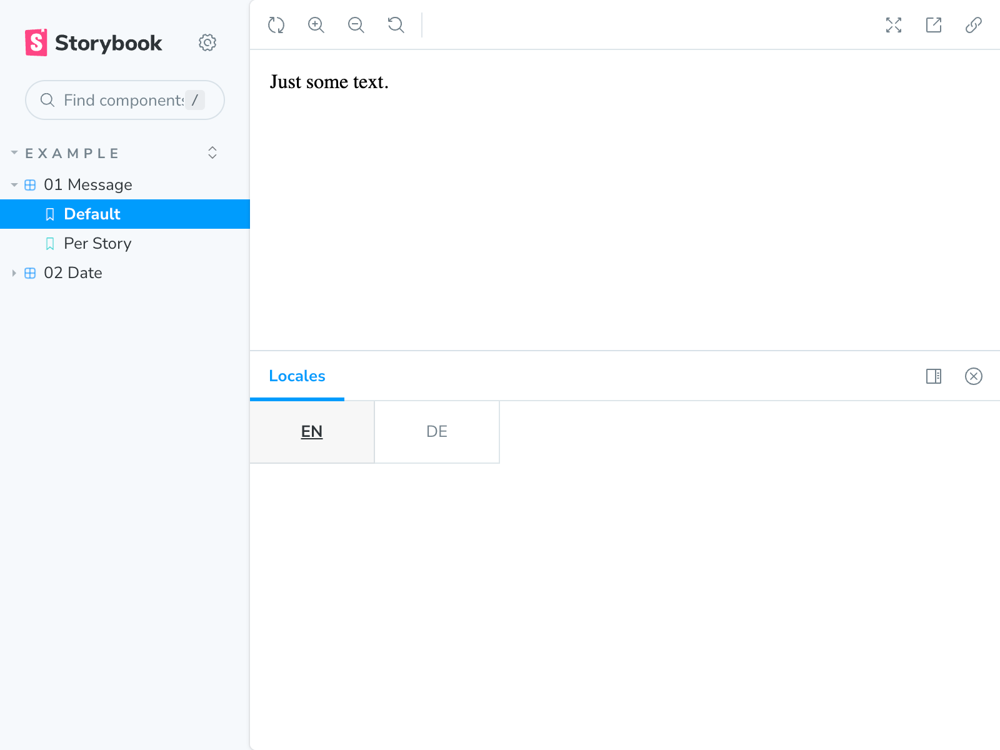

# Storybook Addon Intl

The Intl addon can be used to provide locale switcher and react-intl.

The package is ESM-only and requires Storybook 10. See [Compatibility](#compatibility) for older Storybook versions.



## Getting Started

First, install the addon

```shell
npm install -D storybook-addon-intl
```

Then, register it in `.storybook/main.ts`:

```ts
// Replace react-vite with the framework you use
import { defineMain } from '@storybook/react-vite/node';

export default defineMain({
    // ...rest of config
    addons: ['storybook-addon-intl']
});
```

In `.storybook/preview.js`, add the following:

```js
// Provide your messages
const messages = {
    en: { message: 'Just some text.' },
    de: { message: 'Nur etwas Text.' },
    es: { message: 'Sólo un texto.' }
};

const getMessages = (locale) => messages[locale];

export default {
    parameters: {
        intl: {
            locales: ['en', 'de'],
            defaultLocale: 'en',
            getMessages
        }
    }
};
```

### CSF Next

If you use [CSF Next](https://storybook.js.org/docs/api/csf/csf-next), keep the addon in `.storybook/main.ts` and also register it in `.storybook/preview.ts`:

```ts
// Replace react-vite with the framework you use
import { definePreview } from '@storybook/react-vite';
import intlAddon from 'storybook-addon-intl';

const messages: Record<string, Record<string, string>> = {
    en: { message: 'Just some text.' },
    de: { message: 'Nur etwas Text.' }
};

export default definePreview({
    addons: [intlAddon()],
    parameters: {
        intl: {
            locales: ['en', 'de'],
            defaultLocale: 'en',
            getMessages: (locale: string) => messages[locale]
        }
    }
});
```

## Compatibility

| storybook-addon-intl | Storybook | react-intl            |
| -------------------- | --------- | --------------------- |
| 6.x                  | 10        | 6 to 12               |
| 5.x                  | 9         | 6 to 7 (5.1: 6 to 12) |
| 4.x                  | 8         | 6                     |

## Configuration

Parameter key: `intl`

### `locales`

Type: `string[]`

Available locales.

### `defaultLocale`

Type: `string`

Fallback locale.

### `getMessages`

Type: `(locale: string) => object`

Getter function that takes the active locale as arguments and expects an `object` of messages as a return value.

<small>(See `messages` in [`IntlProvider` docs](https://formatjs.io/docs/react-intl/components#intlprovider) of react-intl)</small>

### `getFormats`

Type: `(locale: string) => object`

Getter function that takes the active locale as arguments and expects an `object` of formats as a return value.

<small>(See `formats` in [`IntlProvider` docs](https://formatjs.io/docs/react-intl/components#intlprovider) of react-intl)</small>

### `defaultRichTextElements`

Type: `object`

Object of rich text elements.

<small>(See `defaultRichTextElements` in [`IntlProvider` docs](https://formatjs.io/docs/react-intl/components#intlprovider) of react-intl)</small>
